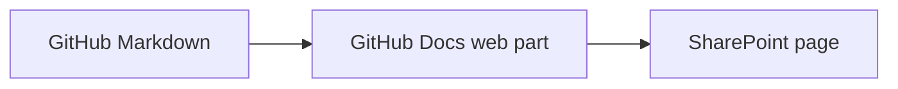

# Markdown

The renderer uses GitHub Flavored Markdown. Raw HTML in the source is shown as text, not executed.

## Table

| File | Role |
| --- | --- |
| `toc.yml` | Tree, titles, and file mapping |
| `*.md` | The pages |
| Images next to the page | Loaded from the same repository |

## Task list

- [x] Write the page in GitHub
- [ ] Refresh the SharePoint page

## Alerts

> [!NOTE]
> Edit this file in the repository. The SharePoint page only chooses which repository to read.

> [!WARNING]
> Do not put a GitHub token in the web part. A private repository is read by the proxy.

## Code

```ts
const tocPath = 'samples/toc.yml';
```

```powershell
npm run build
```

## Link and image

Back to the [overview](../index.md).


## Diagram



## Math

Inline math sits in the sentence, $E = mc^2$, and a block stands alone.

$$
a^2 + b^2 = c^2
$$

## Footnote

The source of truth stays in GitHub.[^1]

[^1]: SharePoint renders it. It does not become the editor.
